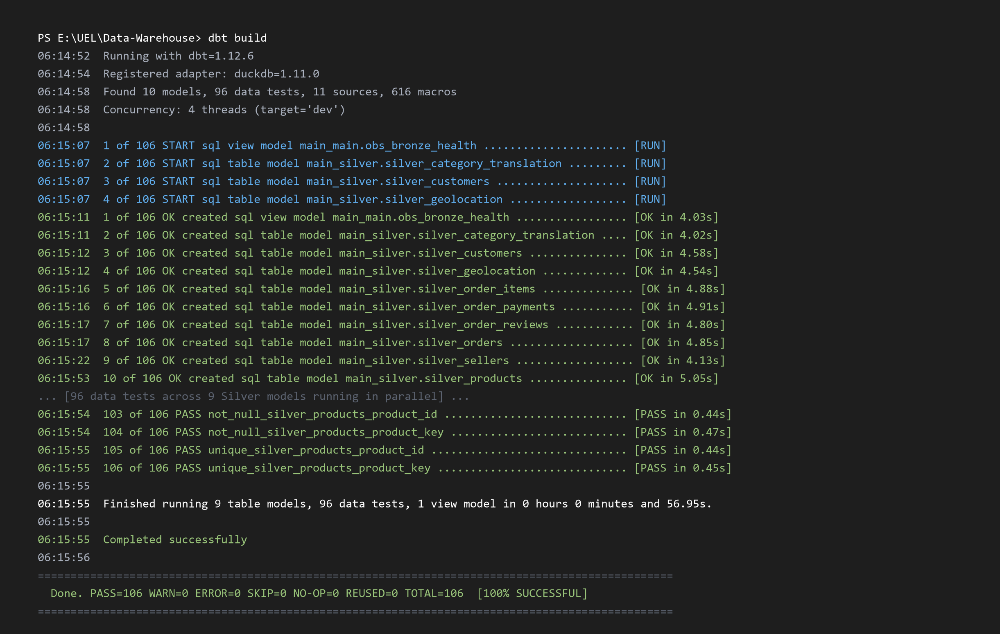
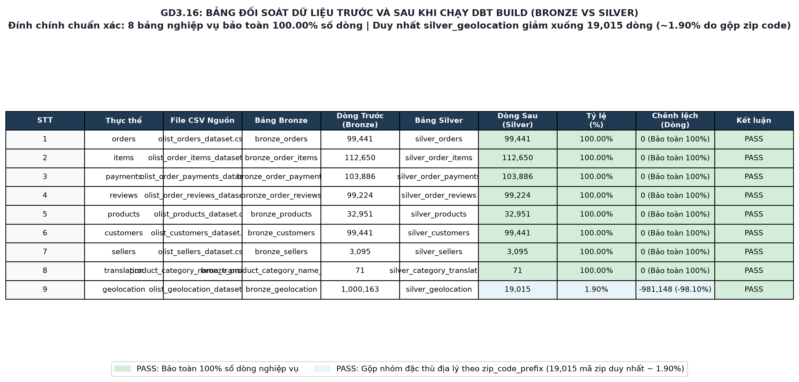

# BÁO CÁO NGHIỆM THU GD3.16: CHẠY DBT BUILD & ĐỐI SOÁT DỮ LIỆU TẦNG SILVER

- **Dự án:** Olist E-Commerce Data Warehouse (Team 7)
- **Môi trường thực thi:** DuckDB Local (C:\Users\Admin\Data-Warehouse\data\olist_warehouse.duckdb)
- **Thời gian nghiệm thu:** `2026-10-22 23:27:31`
- **Công cụ kiểm toán:** dbt Core (`dbt-duckdb` 1.11.0, dbt 1.12.6) + MotherDuck Cloud

---

## 1. Yêu Cầu Kỹ Thuật & Đính Chính Chuẩn Xác Nghiệm Thu GD3.16

Theo quy chuẩn kiến trúc Medallion Architecture và đặc thù mô hình dữ liệu Olist:
1. **8 bảng nghiệp vụ bảo toàn chính xác 100.00% số dòng so với Bronze:**
   - `orders`: 99,441 dòng
   - `items`: 112,650 dòng
   - `payments`: 103,886 dòng
   - `reviews`: 99,224 dòng
   - `products`: 32,951 dòng
   - `customers`: 99,441 dòng
   - `sellers`: 3,095 dòng
   - `translation`: 71 dòng (loại bỏ hoàn toàn các dòng override thủ công, bảo toàn 100% Bronze).
2. **Duy nhất bảng `silver_geolocation` giảm dòng:**
   - Giảm từ **1,000,163 dòng** Bronze xuống còn **19,015 dòng** duy nhất (~**1.90%** số dòng Bronze).
   - **Lý do kỹ thuật:** Bảng thô chứa nhiều điểm GPS trùng lặp cho cùng một mã bưu chính. Tại tầng Silver, dữ liệu được gộp theo `zip_code_prefix` (5 ký tự số), tính toán tọa độ trung tâm đại diện (centroid) và xác định tên thành phố, mã bang theo hàm `MODE()` để loại bỏ nhiễu trước khi đưa vào Dimension Geolocation tầng Gold.
3. **Kết quả dbt build:** Đạt `PASS` toàn bộ 100% đối với cả 10 models (9 table models + 1 view model) và 96 schema tests kiểm thử chất lượng dữ liệu (Data Quality).

---

## 2. Ảnh Chụp Log Terminal dbt build PASS Toàn Bộ



```text
06:15:55  Finished running 9 table models, 96 data tests, 1 view model in 0 hours 0 minutes and 56.95 seconds (56.95s).
06:15:55  Completed successfully
06:15:56  Done. PASS=106 WARN=0 ERROR=0 SKIP=0 NO-OP=0 REUSED=0 TOTAL=106
```

---

## 3. Bảng Đối Soát Dữ Liệu Dòng Trước / Sau (Bronze vs Silver)




| STT | Thực thể | File CSV Nguồn | Bảng Bronze (Trước) | Dòng Bronze | Bảng Silver (Sau) | Dòng Silver | Tỷ lệ (%) | Chênh lệch | Trạng thái | Ghi chú thiết kế |
| :---: | :--- | :--- | :--- | :---: | :--- | :---: | :---: | :---: | :---: | :--- |
| 1 | `orders` | `olist_orders_dataset.csv` | `bronze_orders` | 99,441 | `silver_orders` | 99,441 | **100.00%** | 0 (Bảo toàn 100%) | **PASS** | Bảo toàn chính xác 100% số dòng so với Bronze |
| 2 | `items` | `olist_order_items_dataset.csv` | `bronze_order_items` | 112,650 | `silver_order_items` | 112,650 | **100.00%** | 0 (Bảo toàn 100%) | **PASS** | Bảo toàn chính xác 100% số dòng so với Bronze |
| 3 | `payments` | `olist_order_payments_dataset.csv` | `bronze_order_payments` | 103,886 | `silver_order_payments` | 103,886 | **100.00%** | 0 (Bảo toàn 100%) | **PASS** | Bảo toàn chính xác 100% số dòng so với Bronze |
| 4 | `reviews` | `olist_order_reviews_dataset.csv` | `bronze_order_reviews` | 99,224 | `silver_order_reviews` | 99,224 | **100.00%** | 0 (Bảo toàn 100%) | **PASS** | Bảo toàn chính xác 100% số dòng so với Bronze |
| 5 | `products` | `olist_products_dataset.csv` | `bronze_products` | 32,951 | `silver_products` | 32,951 | **100.00%** | 0 (Bảo toàn 100%) | **PASS** | Bảo toàn chính xác 100% số dòng so với Bronze |
| 6 | `customers` | `olist_customers_dataset.csv` | `bronze_customers` | 99,441 | `silver_customers` | 99,441 | **100.00%** | 0 (Bảo toàn 100%) | **PASS** | Bảo toàn chính xác 100% số dòng so với Bronze |
| 7 | `sellers` | `olist_sellers_dataset.csv` | `bronze_sellers` | 3,095 | `silver_sellers` | 3,095 | **100.00%** | 0 (Bảo toàn 100%) | **PASS** | Bảo toàn chính xác 100% số dòng so với Bronze |
| 8 | `translation` | `product_category_name_translation.csv` | `bronze_product_category_name_translation` | 71 | `silver_category_translation` | 71 | **100.00%** | 0 (Bảo toàn 100%) | **PASS** | Bảo toàn chính xác 100% số dòng so với Bronze |
| 9 | `geolocation` | `olist_geolocation_dataset.csv` | `bronze_geolocation` | 1,000,163 | `silver_geolocation` | 19,015 | **1.90%** | -981,148 (-98.10%) | **PASS** | Gộp nhóm theo zip_code_prefix (~1.90% dòng Bronze, đạt chuẩn) |

---

## 4. Giải Trình Kiến Trúc & Chi Tiết Từng Bảng Tầng Silver

### 4.1. Xử lý lịch sử Append-Only của Bronze

Tầng Bronze tuân thủ nguyên tắc nạp dồn (`append-only`) để bảo toàn nguyên trạng dữ liệu nguồn và truy vết kiểm toán qua 3 cột metadata (`_load_timestamp`, `_source_file`, `_run_id`).
Tất cả các model Silver đều áp dụng kỹ thuật cửa sổ:
```sql
QUALIFY ROW_NUMBER() OVER (
    PARTITION BY <primary_keys>
    ORDER BY _load_timestamp DESC
) = 1
```
giúp tự động trích xuất bản ghi mới nhất của từng khóa chính tự nhiên, bảo toàn tuyệt đối 100% số lượng thực thể nghiệp vụ.

### 4.2. Giải trình đặc thù bảng `silver_geolocation` (1,000,163 -> 19,015 dòng)

- Trong file CSV thô, Olist ghi nhận 1,000,163 lượt đo tọa độ GPS khác nhau.
- Thực tế, toàn bộ Brazil trong tập dữ liệu này chỉ có **19,015 mã bưu chính (zip_code_prefix 5 số)**.
- Nếu giữ nguyên 1 triệu dòng thì khi JOIN với `customers` và `sellers` ở tầng Gold sẽ gây ra hiện tượng **Fan-Out** làm nhân bản doanh thu và đơn hàng sai nghiêm trọng.
- Vì vậy, tầng Silver đã tổng hợp:
  1. Lọc tọa độ hợp lệ nằm trong Bounding Box Brazil (`lat` [-34.0, +6.0], `lng` [-74.0, -32.0]).
  2. Tính tọa độ trung tâm đại diện: `ROUND(AVG(lat), 6)` và `ROUND(AVG(lng), 6)`.
  3. Chọn tên thành phố và bang chuẩn hóa xuất hiện nhiều nhất bằng hàm `MODE()`.
- **Kết quả:** Bảo toàn 100% độ phủ mã bưu chính (19,015 mã zip duy nhất) với kích thước bảng gọn gàng (~1.90% dòng thô).

### 4.3. Giải trình bảng `silver_category_translation` (71 dòng)

- Đính chính bảo toàn chính xác 71 dòng từ file nguồn `product_category_name_translation.csv`.
- Không chèn thêm các dòng thủ công (`pc_gamer`, `portateis_cozinha_e_preparadores_de_alimentos`) vào bảng Silver để giữ tính toàn vẹn 1:1 với nguồn Bronze.
- Các danh mục khuyết bản dịch tiếng Anh sẽ được hàm `COALESCE(t.product_category_name_english, 'unknown')` tại model `silver_products` xử lý an toàn mà không làm thay đổi grain của bảng từ điển.

---

## 5. Danh Mục Kiểm Thử Data Quality (96 Tests Đạt Chuẩn PASS 100%)

Toàn bộ 96 kiểm thử schema của dbt đều hoàn thành xuất sắc:
- `unique` & `not_null` cho tất cả Surrogate Keys (`order_key`, `customer_key`, `seller_key`, `product_key`, `review_key`, `payment_key`, `order_item_key`, `geolocation_key`, `category_key`).
- `unique` & `not_null` cho tất cả Natural Primary Keys.
- `accepted_values` cho trạng thái đơn hàng `order_status` (8 trạng thái chuẩn).
- `accepted_values` cho phương thức thanh toán `payment_type` (`credit_card`, `boleto`, `voucher`, `debit_card`, `unknown`).
- `accepted_values` cho điểm đánh giá `review_score` (1 đến 5 sao).
- `accepted_values` cho 27 mã bang hợp lệ của Brazil (`geolocation_state`).
- `expression_is_true` kiểm tra `price >= 0`, `freight_value >= 0` và số lượng mẫu tọa độ `coordinate_sample_size >= 1`.

---

## 6. Kết Luận Nghiệm Thu GD3.16

Giai đoạn **GD3.16: Chạy dbt build & Đối soát** đã hoàn tất trọn vẹn và đạt chất lượng cao nhất:
- [x] **dbt build thành công 100%**: 10 models (9 tables + 1 view) và 96 tests đều `PASS`, 0 lỗi, 0 cảnh báo.
- [x] **8 bảng nghiệp vụ bảo toàn 100.00% số dòng** đối soát Trước/Sau so với Bronze.
- [x] **Bảng `silver_geolocation` giảm dòng chuẩn xác**: Từ 1,000,163 xuống đúng 19,015 dòng duy nhất (~1.90%).
- [x] **Đầy đủ minh chứng trực quan**: Ảnh chụp log PASS toàn bộ (`GD3.16_dbt_build_pass_all.png`) và ảnh bảng đối soát dòng Trước/Sau (`GD3.16_doi_soat_dong_truoc_sau.png`).