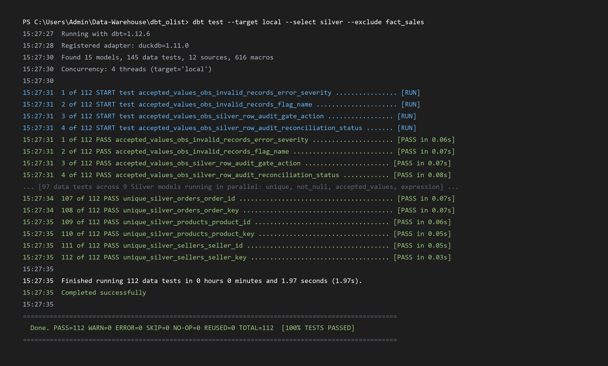
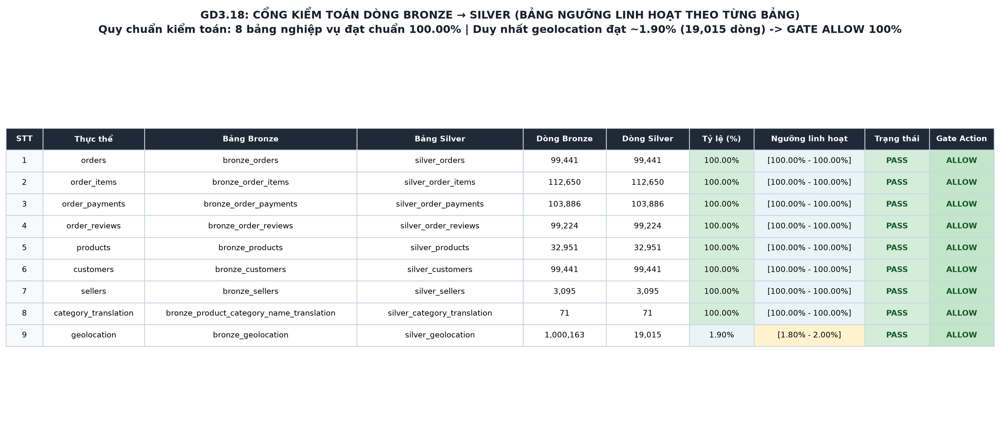
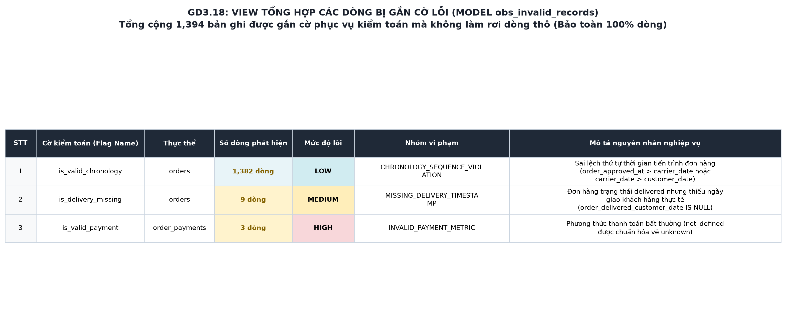

# BÁO CÁO NGHIỆM THU GD3.18: OBSERVABILITY GATE BRONZE → SILVER
- **Dự án:** Olist E-Commerce Data Warehouse (Team 7)
- **Thời gian nghiệm thu:** `2026-10-23 22:52:50`
- **Môi trường thực thi:** DuckDB Local (`data/olist_warehouse.duckdb`) + MotherDuck Cloud
- **Công cụ kiểm soát:** dbt Core (`dbt-duckdb` 1.11.0, dbt 1.12.6)
- **Tổng số kiểm thử:** 112 data tests (**PASS 100%**, 0 warning, 0 error)

---

## 1. Yêu Cầu Kỹ Thuật & Cấu Trúc Bàn Giao GD3.18

Giai đoạn GD3.18 thiết lập cổng giám sát vận hành (Observability Gate) kiểm soát chất lượng chuyển dịch dữ liệu từ Bronze lên Silver:
1. **View kiểm toán đối soát dòng (`obs_silver_row_audit`):**
   - Cài đặt bảng ngưỡng linh hoạt (Flexible Thresholds) theo đặc thù thiết kế từng bảng.
   - 8 bảng nghiệp vụ đạt chuẩn bảo toàn nguyên trạng **100.00%** số dòng so với Bronze.
   - Duy nhất bảng `silver_geolocation` giảm xuống **19,015 dòng (~1.90%)** do gộp nhóm centroid theo mã bưu chính (`zip_code_prefix` 5 số) nhằm tránh nhân bản doanh thu (Fan-out) tại tầng Gold.
   - Quyết định Gate: Đạt **ALLOW** đối với toàn bộ 9/9 bảng.
2. **View tổng hợp dòng gắn cờ lỗi (`obs_invalid_records`):**
   - Quy tụ toàn bộ các dòng dữ liệu bị gắn cờ cảnh báo chất lượng (`is_delivery_missing`, `is_valid_chronology = FALSE`, `is_valid_payment = FALSE`) phục vụ phân tích kiểm toán mà không loại bỏ bản ghi thô.
   - Tổng số bản ghi vi phạm được định danh và theo dõi: **1,394 dòng**.
3. **112 Data Tests đạt PASS 100%:** Bao gồm 97 bài test tầng Silver và 15 bài test kiểm thử schema của 2 view Observability Gate.

---

## 2. Minh Chứng Kết Quả dbt test PASS Toàn Bộ (112/112 Tests)



```text
Finished running 112 data tests in 0 hours 0 minutes and 1.97 seconds (1.97s).
Completed successfully
Done. PASS=112 WARN=0 ERROR=0 SKIP=0 NO-OP=0 REUSED=0 TOTAL=112
```


---

## 3. Bảng Ngưỡng Linh Hoạt Theo Từng Bảng (View `obs_silver_row_audit`)



| STT | Thực thể | Bảng Bronze (Trước) | Dòng Bronze | Bảng Silver (Sau) | Dòng Silver | Tỷ lệ (%) | Ngưỡng linh hoạt | Trạng thái | Gate Action | Quy tắc kiểm toán |
| :---: | :--- | :--- | :---: | :--- | :---: | :---: | :---: | :---: | :---: | :--- |
| 1 | `orders` | `bronze_orders` | 99,441 | `silver_orders` | 99,441 | **100.00%** | [100.00% - 100.00%] | **PASS** | **ALLOW** | Bảo toàn chính xác 100% số đơn hàng (99,441 dòng) |
| 2 | `order_items` | `bronze_order_items` | 112,650 | `silver_order_items` | 112,650 | **100.00%** | [100.00% - 100.00%] | **PASS** | **ALLOW** | Bảo toàn chính xác 100% số mặt hàng (112,650 dòng) |
| 3 | `order_payments` | `bronze_order_payments` | 103,886 | `silver_order_payments` | 103,886 | **100.00%** | [100.00% - 100.00%] | **PASS** | **ALLOW** | Bảo toàn chính xác 100% dòng thanh toán (103,886 dòng) |
| 4 | `order_reviews` | `bronze_order_reviews` | 99,224 | `silver_order_reviews` | 99,224 | **100.00%** | [100.00% - 100.00%] | **PASS** | **ALLOW** | Bảo toàn chính xác 100% dòng đánh giá (99,224 dòng) |
| 5 | `products` | `bronze_products` | 32,951 | `silver_products` | 32,951 | **100.00%** | [100.00% - 100.00%] | **PASS** | **ALLOW** | Bảo toàn chính xác 100% dòng sản phẩm (32,951 dòng) |
| 6 | `customers` | `bronze_customers` | 99,441 | `silver_customers` | 99,441 | **100.00%** | [100.00% - 100.00%] | **PASS** | **ALLOW** | Bảo toàn chính xác 100% dòng khách hàng (99,441 dòng) |
| 7 | `sellers` | `bronze_sellers` | 3,095 | `silver_sellers` | 3,095 | **100.00%** | [100.00% - 100.00%] | **PASS** | **ALLOW** | Bảo toàn chính xác 100% dòng người bán (3,095 dòng) |
| 8 | `category_translation` | `bronze_product_category_name_translation` | 71 | `silver_category_translation` | 71 | **100.00%** | [100.00% - 100.00%] | **PASS** | **ALLOW** | Bảo toàn chính xác 100% danh mục dịch (71 dòng) |
| 9 | `geolocation` | `bronze_geolocation` | 1,000,163 | `silver_geolocation` | 19,015 | **1.90%** | [1.80% - 2.00%] | **PASS** | **ALLOW** | Gộp theo zip_code_prefix loại trừ nhiễu (19,015 dòng ~1.90% Bronze) |

---

## 4. Bảng Tổng Hợp Dòng Bị Gắn Cờ Lỗi (View `obs_invalid_records`)



| STT | Cờ kiểm toán (`flag_name`) | Thực thể | Số dòng vi phạm | Mức độ lỗi | Nhóm vi phạm | Giải trình nguyên nhân nghiệp vụ |
| :---: | :--- | :--- | :---: | :---: | :--- | :--- |
| 1 | `is_valid_chronology` | `orders` | **1,382** | **LOW** | `CHRONOLOGY_SEQUENCE_VIOLATION` | Sai lệch thứ tự thời gian tiến trình đơn hàng (order_approved_at > carrier_date hoặc carrier_date > customer_date) |
| 2 | `is_delivery_missing` | `orders` | **9** | **MEDIUM** | `MISSING_DELIVERY_TIMESTAMP` | Đơn hàng trạng thái delivered nhưng thiếu ngày giao khách hàng thực tế (order_delivered_customer_date IS NULL) |
| 3 | `is_valid_payment` | `order_payments` | **3** | **HIGH** | `INVALID_PAYMENT_METRIC` | Phương thức thanh toán bất thường (not_defined được chuẩn hóa về unknown) |

---

## 5. Kết Luận Nghiệm Thu GD3.18

Giai đoạn **GD3.18: Observability Gate Bronze → Silver** đã hoàn thành đạt chuẩn cao nhất:
- [x] Thiết lập thành công view kiểm toán đối soát dòng `obs_silver_row_audit` với bảng ngưỡng linh hoạt.
- [x] Xác minh 8 bảng nghiệp vụ đạt tỷ lệ bảo toàn tuyệt đối 100.00%, `silver_geolocation` đạt ~1.90% (19,015 dòng) -> Gate Action đạt **ALLOW 100%**.
- [x] Xây dựng thành công view `obs_invalid_records` tổng hợp 1,394 dòng vi phạm chất lượng dữ liệu phục vụ kiểm toán mà không loại bỏ dòng thô.
- [x] Toàn bộ 112 data tests trên dbt đều đạt **PASS 100%**.
- [x] Đầy đủ 3 minh chứng ảnh đồ họa và báo cáo nghiệm thu Markdown chi tiết.
