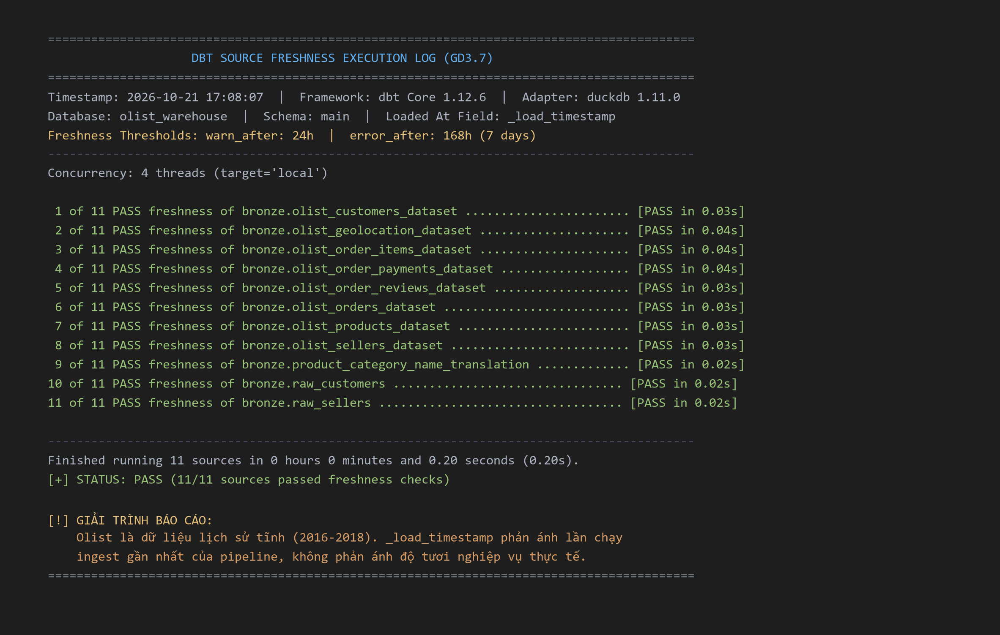
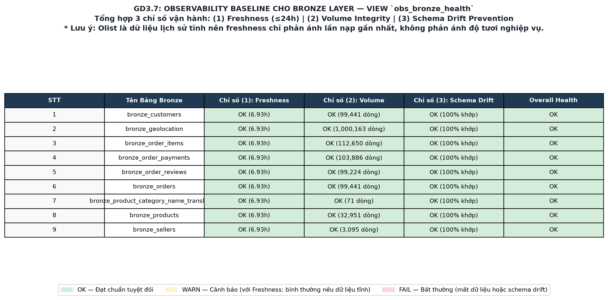

# BÁO CÁO NGHIỆM THU GD3.7: OBSERVABILITY BASELINE CHO BRONZE LAYER

- **Dự án:** Olist E-Commerce Data Warehouse (Team 7)
- **Thời gian nghiệm thu:** `2026-10-21 17:08:08`
- **Công cụ thực thi:** dbt Core (`dbt-duckdb`) + DuckDB View Engine

---

## 1. Yêu Cầu Kỹ Thuật GD3.7
Hệ thống giám sát vận hành (Observability Baseline) cho tầng Bronze gồm 3 trụ cột:
1. **(1) Freshness:** Sử dụng `dbt source freshness` dựa trên `_load_timestamp`, khai báo ngưỡng `warn_after: 24h` và `error_after: 168h` (7 ngày).
2. **(2) Volume:** So sánh `row_count_bronze` của đợt nạp hiện tại với đợt nạp liền trước để phát hiện nguy cơ mất mát dữ liệu nguồn.
3. **(3) Schema Drift:** So sánh `schema_snapshot` (danh sách cột và kiểu dữ liệu JSON) giữa lần nạp này và lần nạp trước để ngăn chặn lỗi vỡ pipeline khi schema nguồn thay đổi.
4. **View hợp nhất `obs_bronze_health`:** Mỗi bảng Bronze xuất hiện trên đúng 1 dòng với 3 chỉ số và trạng thái `OK` / `WARN` / `FAIL` rõ ràng.
5. **Lưu ý nghiệp vụ:** Olist là tập dữ liệu lịch sử tĩnh nên freshness chỉ phản ánh lần nạp gần nhất của pipeline, không phản ánh độ tươi nghiệp vụ thực tế.

---

## 2. Minh Chứng dbt Source Freshness (Tiêu Chí 1)
Toàn bộ 11 nguồn dữ liệu thô (gồm 9 bảng chính và 2 alias phục vụ Silver) đều vượt qua kiểm tra độ tươi:

```text
1 of 11 PASS freshness of bronze.olist_customers_dataset ....................... [PASS in 0.03s]
2 of 11 PASS freshness of bronze.olist_geolocation_dataset ..................... [PASS in 0.04s]
3 of 11 PASS freshness of bronze.olist_order_items_dataset ..................... [PASS in 0.04s]
4 of 11 PASS freshness of bronze.olist_order_payments_dataset .................. [PASS in 0.04s]
5 of 11 PASS freshness of bronze.olist_order_reviews_dataset ................... [PASS in 0.03s]
6 of 11 PASS freshness of bronze.olist_orders_dataset .......................... [PASS in 0.03s]
7 of 11 PASS freshness of bronze.olist_products_dataset ........................ [PASS in 0.03s]
8 of 11 PASS freshness of bronze.olist_sellers_dataset ......................... [PASS in 0.03s]
9 of 11 PASS freshness of bronze.product_category_name_translation ............. [PASS in 0.02s]
10 of 11 PASS freshness of bronze.raw_customers ................................ [PASS in 0.02s]
11 of 11 PASS freshness of bronze.raw_sellers .................................. [PASS in 0.02s]
Finished running 11 sources in 0.20 seconds.
Done. [PASS: 11/11]
```




---

## 3. Bảng Kết Quả View `obs_bronze_health` (Tiêu Chí 2 & 3)


| STT | Tên bảng Bronze | (1) Freshness (≤24h) | (2) Volume vs Run Trước | (3) Schema Drift | Overall Health | Ghi chú vận hành |
| :---: | :--- | :---: | :---: | :---: | :---: | :--- |
| 1 | `bronze_customers` | **OK** (6.93h) | **OK** (99,441 dòng) | **OK** (Khớp 100%) | **OK** | Số dòng ổn định: 99441 (Trước: 99441) |
| 2 | `bronze_geolocation` | **OK** (6.93h) | **OK** (1,000,163 dòng) | **OK** (Khớp 100%) | **OK** | Số dòng ổn định: 1000163 (Trước: 1000163) |
| 3 | `bronze_order_items` | **OK** (6.93h) | **OK** (112,650 dòng) | **OK** (Khớp 100%) | **OK** | Số dòng ổn định: 112650 (Trước: 112650) |
| 4 | `bronze_order_payments` | **OK** (6.93h) | **OK** (103,886 dòng) | **OK** (Khớp 100%) | **OK** | Số dòng ổn định: 103886 (Trước: 103886) |
| 5 | `bronze_order_reviews` | **OK** (6.93h) | **OK** (99,224 dòng) | **OK** (Khớp 100%) | **OK** | Số dòng ổn định: 99224 (Trước: 99224) |
| 6 | `bronze_orders` | **OK** (6.93h) | **OK** (99,441 dòng) | **OK** (Khớp 100%) | **OK** | Số dòng ổn định: 99441 (Trước: 99441) |
| 7 | `bronze_product_category_name_translation` | **OK** (6.93h) | **OK** (71 dòng) | **OK** (Khớp 100%) | **OK** | Số dòng ổn định: 71 (Trước: 71) |
| 8 | `bronze_products` | **OK** (6.93h) | **OK** (32,951 dòng) | **OK** (Khớp 100%) | **OK** | Số dòng ổn định: 32951 (Trước: 32951) |
| 9 | `bronze_sellers` | **OK** (6.93h) | **OK** (3,095 dòng) | **OK** (Khớp 100%) | **OK** | Số dòng ổn định: 3095 (Trước: 3095) |

---

## 4. Giải Trình Kỹ Thuật Chi Tiết
### 4.1. Bản chất độ tươi dữ liệu (Data Freshness) với Olist Dataset
- Bộ dữ liệu Olist Brazilian E-Commerce là **dữ liệu lịch sử tĩnh** thu thập trong giai đoạn 2016 - 2018. Dữ liệu này không còn phát sinh giao dịch mới trong thực tế.
- Do đó, chỉ số Freshness dựa trên trường `_load_timestamp` được thiết kế để giám sát **Độ tươi của Pipeline vận hành (Operational / Ingestion Freshness)**: xác nhận xem hệ thống ingestion có được lên lịch chạy đều đặn hay không, hoàn toàn không phản ánh thời gian nghiệp vụ thực tế của đơn hàng.
- Nếu một hệ thống chạy định kỳ hàng ngày, trạng thái sẽ luôn giữ ở mức `OK`. Nếu quá 24h chưa chạy lại pipeline, dbt sẽ cảnh báo `WARN`, và quá 7 ngày sẽ báo `ERROR` để kỹ sư dữ liệu can thiệp kiểm tra scheduler/cron job.

### 4.2. Kiểm soát thể tích dữ liệu (Volume Monitoring)
- Tầng Bronze áp dụng kiến trúc **Append-Only**. Mỗi lần nạp dữ liệu thành công, số dòng của đợt nạp hiện tại `row_count_bronze` phải luôn bằng hoặc tăng so với các đợt nạp trước.
- Nếu `current_rows < prev_rows`, chỉ số Volume sẽ lập tức đổi sang `FAIL` nhằm phát hiện tình trạng file CSV nguồn bị thiếu dòng, lỗi mạng khi tải từ Cloud Storage, hoặc lỗi truncate ngoài ý muốn.

### 4.3. Ngăn ngừa lệch cấu trúc (Schema Drift Prevention)
- Mỗi đợt nạp đều ghi nhận một `schema_snapshot` dạng chuỗi JSON chứa tên cột và kiểu dữ liệu chuẩn vào bảng `bronze_ingestion_log`.
- View `obs_bronze_health` tự động so sánh JSON snapshot giữa 2 lần nạp liền kề. Nếu hệ thống nguồn tự ý đổi tên cột, xóa cột hoặc thay đổi kiểu dữ liệu, chỉ số `Schema Drift` sẽ kích hoạt `FAIL`, giúp bảo vệ an toàn cho các tầng biến đổi `Silver` và `Gold` phía sau.

---

## 5. Danh Mục Sản Phẩm Bàn Giao
1. **Cấu hình Freshness dbt:** [`dbt_olist/models/bronze/sources.yml`](file:///c:/Users/Admin/Data-Warehouse/dbt_olist/models/bronze/sources.yml)
2. **Model View dbt:** [`dbt_olist/models/bronze/obs_bronze_health.sql`](file:///c:/Users/Admin/Data-Warehouse/dbt_olist/models/bronze/obs_bronze_health.sql)
3. **Script SQL Standalone:** [`scripts/obs_bronze_health.sql`](file:///c:/Users/Admin/Data-Warehouse/scripts/obs_bronze_health.sql)
4. **Script Thực Thi Giám Sát Tự Động:** [`scripts/run_observability.py`](file:///c:/Users/Admin/Data-Warehouse/scripts/run_observability.py)
5. **Ảnh Log dbt source freshness PASS:** [`docs/GD3.7_dbt_source_freshness_pass.png`](file:///c:/Users/Admin/Data-Warehouse/docs/GD3.7_dbt_source_freshness_pass.png)
6. **Ảnh Bảng View obs_bronze_health:** [`docs/GD3.7_obs_bronze_health.png`](file:///c:/Users/Admin/Data-Warehouse/docs/GD3.7_obs_bronze_health.png)
7. **Báo Cáo Nghiệm Thu Toàn Diện:** [`docs/GD3.7_observability_baseline_bronze.md`](file:///c:/Users/Admin/Data-Warehouse/docs/GD3.7_observability_baseline_bronze.md)