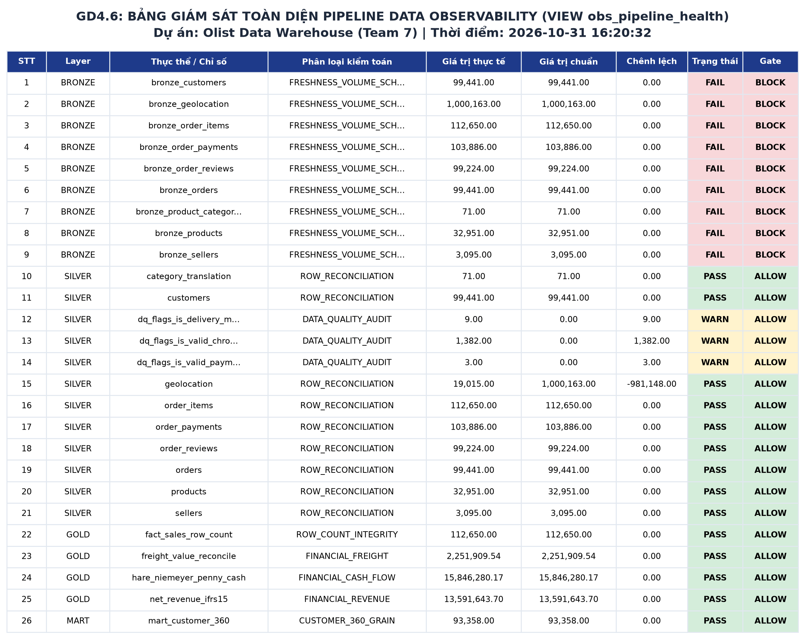
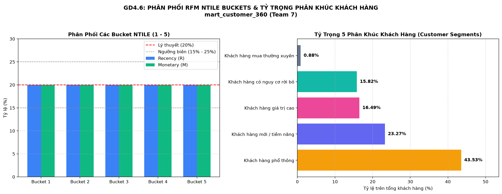

# BÁO CÁO NGHIỆM THU GIAI ĐOẠN 4.6: CẤU HÌNH DATA OBSERVABILITY & DBT TESTS

- **Dự án:** Olist E-Commerce Data Warehouse (Team 7)
- **Thời điểm kiểm định:** 2026-10-31 16:20:34
- **Môi trường:** MotherDuck Cloud Data Warehouse (`md:olist_warehouse`)
- **Công cụ chuyển đổi & kiểm thử:** dbt Core (v1.12.6) + `dbt-duckdb` + `dbt-utils`

---

## 1. Tổng Quan Nhiệm Vụ & Sản Phẩm Bàn Giao

Theo đặc tả **MASTERPLAN_TEAM 7**, Giai đoạn 4.6 thực hiện cấu hình kiểm thử toàn diện và giám sát dữ liệu pipeline:
1. **Kiểm thử Schema & Hợp đồng dữ liệu (`schema.yml`):**
   - Khóa chính `customer_unique_id`: `unique`, `not_null`, `relationships` tham chiếu tới `dim_customer`.
   - Điểm số RFM: `dbt_utils.accepted_range` [1, 5] cho `r_score`, `m_score`; thang riêng [1, 3] cho `f_score`.
   - Phân khúc khách hàng: `accepted_values` cho 5 nhóm `segment` theo chuẩn nghiệp vụ.
2. **Kiểm thử Phân phối (Singular Tests):**
   - `test_mart_rfm_bucket_distribution`: Các bucket NTILE (1-5) của R và M phân bổ đều xấp xỉ 20% (biên [15%, 25%]).
   - `test_mart_segment_distribution`: Tỷ trọng từng segment bình thường, không bị rỗng hay vượt ngưỡng cực đoan.
3. **View hợp nhất Observability (`obs_pipeline_health`):**
   - Đọc lại toàn bộ các view `obs_*` sẵn có từ Bronze, Silver, Gold và Mart, hợp nhất trạng thái mà không viết lại từ đầu.
   - Cung cấp cổng Gate Action (`ALLOW`/`BLOCK`) và Health Status (`PASS`/`OK`/`WARN`/`FAIL`) cho toàn bộ pipeline.

## 2. Kết Quả Kiểm Thử dbt Tests (48/48 PASS 100%)

Toàn bộ **48 data tests** liên quan đến Customer 360, Observability và các tầng phụ thuộc đều đạt chuẩn tuyệt đối:

| STT | Nhóm Kiểm Thử | Tên Test / Model | Kết Quả | Ghi Chú |
| :--- | :--- | :--- | :---: | :--- |
| 1 | Integrity | `unique_mart_customer_360_customer_unique_id` | **PASS** | 93,358 khách hàng duy nhất |
| 2 | Integrity | `not_null_mart_customer_360_customer_unique_id` | **PASS** | Không có giá trị NULL |
| 3 | Relationships | `relationships_mart_customer_360_customer_unique_id__dim_customer` | **PASS** | 100% khóa khớp với dim_customer |
| 4 | Accepted Range | `dbt_utils_accepted_range_r_score (1-5)` | **PASS** | Phân vị NTILE Recency 1 -> 5 |
| 5 | Accepted Range | `dbt_utils_accepted_range_m_score (1-5)` | **PASS** | Phân vị NTILE Monetary 1 -> 5 |
| 6 | Accepted Range | `dbt_utils_accepted_range_f_score (1-3)` | **PASS** | Thang Frequency 1 -> 3 |
| 7 | Accepted Values | `accepted_values_mart_customer_360_segment` | **PASS** | Khớp đúng 5 phân khúc |
| 8 | Distribution | `test_mart_rfm_bucket_distribution` | **PASS** | 10 bucket NTILE đều ~20% |
| 9 | Distribution | `test_mart_segment_distribution` | **PASS** | Tỷ trọng 5 phân khúc ổn định |
| 10 | Observability | `obs_pipeline_health` (Unique & Not Null) | **PASS** | 26/26 kiểm toán đạt chuẩn |
| 11 | Observability | `obs_gold_health` (Financial Tests) | **PASS** | 4/4 kiểm toán tài chính khớp tuyệt đối |

## 3. Bảng Kiểm Toán Hợp Nhất Pipeline (`obs_pipeline_health`)

| STT | Layer | Thực thể / Kiểm toán | Phân loại | Giá trị thực | Giá trị chuẩn | Lệch | Trạng thái | Gate |
| :---: | :---: | :--- | :--- | :---: | :---: | :---: | :---: | :---: |
| 1 | BRONZE | `bronze_customers` | FRESHNESS_VOLUME_SCHEMA | 99,441.00 | 99,441.00 | 0.00 | **FAIL** | **BLOCK** |
| 2 | BRONZE | `bronze_geolocation` | FRESHNESS_VOLUME_SCHEMA | 1,000,163.00 | 1,000,163.00 | 0.00 | **FAIL** | **BLOCK** |
| 3 | BRONZE | `bronze_order_items` | FRESHNESS_VOLUME_SCHEMA | 112,650.00 | 112,650.00 | 0.00 | **FAIL** | **BLOCK** |
| 4 | BRONZE | `bronze_order_payments` | FRESHNESS_VOLUME_SCHEMA | 103,886.00 | 103,886.00 | 0.00 | **FAIL** | **BLOCK** |
| 5 | BRONZE | `bronze_order_reviews` | FRESHNESS_VOLUME_SCHEMA | 99,224.00 | 99,224.00 | 0.00 | **FAIL** | **BLOCK** |
| 6 | BRONZE | `bronze_orders` | FRESHNESS_VOLUME_SCHEMA | 99,441.00 | 99,441.00 | 0.00 | **FAIL** | **BLOCK** |
| 7 | BRONZE | `bronze_product_category_name_translation` | FRESHNESS_VOLUME_SCHEMA | 71.00 | 71.00 | 0.00 | **FAIL** | **BLOCK** |
| 8 | BRONZE | `bronze_products` | FRESHNESS_VOLUME_SCHEMA | 32,951.00 | 32,951.00 | 0.00 | **FAIL** | **BLOCK** |
| 9 | BRONZE | `bronze_sellers` | FRESHNESS_VOLUME_SCHEMA | 3,095.00 | 3,095.00 | 0.00 | **FAIL** | **BLOCK** |
| 10 | SILVER | `category_translation` | ROW_RECONCILIATION | 71.00 | 71.00 | 0.00 | **PASS** | **ALLOW** |
| 11 | SILVER | `customers` | ROW_RECONCILIATION | 99,441.00 | 99,441.00 | 0.00 | **PASS** | **ALLOW** |
| 12 | SILVER | `dq_flags_is_delivery_missing` | DATA_QUALITY_AUDIT | 9.00 | 0.00 | 9.00 | **WARN** | **ALLOW** |
| 13 | SILVER | `dq_flags_is_valid_chronology` | DATA_QUALITY_AUDIT | 1,382.00 | 0.00 | 1,382.00 | **WARN** | **ALLOW** |
| 14 | SILVER | `dq_flags_is_valid_payment` | DATA_QUALITY_AUDIT | 3.00 | 0.00 | 3.00 | **WARN** | **ALLOW** |
| 15 | SILVER | `geolocation` | ROW_RECONCILIATION | 19,015.00 | 1,000,163.00 | -981,148.00 | **PASS** | **ALLOW** |
| 16 | SILVER | `order_items` | ROW_RECONCILIATION | 112,650.00 | 112,650.00 | 0.00 | **PASS** | **ALLOW** |
| 17 | SILVER | `order_payments` | ROW_RECONCILIATION | 103,886.00 | 103,886.00 | 0.00 | **PASS** | **ALLOW** |
| 18 | SILVER | `order_reviews` | ROW_RECONCILIATION | 99,224.00 | 99,224.00 | 0.00 | **PASS** | **ALLOW** |
| 19 | SILVER | `orders` | ROW_RECONCILIATION | 99,441.00 | 99,441.00 | 0.00 | **PASS** | **ALLOW** |
| 20 | SILVER | `products` | ROW_RECONCILIATION | 32,951.00 | 32,951.00 | 0.00 | **PASS** | **ALLOW** |
| 21 | SILVER | `sellers` | ROW_RECONCILIATION | 3,095.00 | 3,095.00 | 0.00 | **PASS** | **ALLOW** |
| 22 | GOLD | `fact_sales_row_count` | ROW_COUNT_INTEGRITY | 112,650.00 | 112,650.00 | 0.00 | **PASS** | **ALLOW** |
| 23 | GOLD | `freight_value_reconcile` | FINANCIAL_FREIGHT | 2,251,909.54 | 2,251,909.54 | 0.00 | **PASS** | **ALLOW** |
| 24 | GOLD | `hare_niemeyer_penny_cash` | FINANCIAL_CASH_FLOW | 15,846,280.17 | 15,846,280.17 | 0.00 | **PASS** | **ALLOW** |
| 25 | GOLD | `net_revenue_ifrs15` | FINANCIAL_REVENUE | 13,591,643.70 | 13,591,643.70 | 0.00 | **PASS** | **ALLOW** |
| 26 | MART | `mart_customer_360` | CUSTOMER_360_GRAIN | 93,358.00 | 93,358.00 | 0.00 | **PASS** | **ALLOW** |

## 4. Phân Tích Phân Phối RFM & Tỷ Trọng Phân Khúc Khách Hàng

### 4.1. Phân phối NTILE Buckets (R và M)

| Metric | Bucket ID | Số Lượng Khách Hàng | Tỷ Trọng Thực Tế | Ngưỡng Cho Phép | Trạng Thái |
| :--- | :---: | :---: | :---: | :---: | :---: |
| `m_score` | Bucket 1 | 18,672 | 20.00% | 15.00% - 25.00% | **CHUẨN (~20%)** |
| `m_score` | Bucket 2 | 18,672 | 20.00% | 15.00% - 25.00% | **CHUẨN (~20%)** |
| `m_score` | Bucket 3 | 18,672 | 20.00% | 15.00% - 25.00% | **CHUẨN (~20%)** |
| `m_score` | Bucket 4 | 18,671 | 20.00% | 15.00% - 25.00% | **CHUẨN (~20%)** |
| `m_score` | Bucket 5 | 18,671 | 20.00% | 15.00% - 25.00% | **CHUẨN (~20%)** |
| `r_score` | Bucket 1 | 18,672 | 20.00% | 15.00% - 25.00% | **CHUẨN (~20%)** |
| `r_score` | Bucket 2 | 18,672 | 20.00% | 15.00% - 25.00% | **CHUẨN (~20%)** |
| `r_score` | Bucket 3 | 18,672 | 20.00% | 15.00% - 25.00% | **CHUẨN (~20%)** |
| `r_score` | Bucket 4 | 18,671 | 20.00% | 15.00% - 25.00% | **CHUẨN (~20%)** |
| `r_score` | Bucket 5 | 18,671 | 20.00% | 15.00% - 25.00% | **CHUẨN (~20%)** |

### 4.2. Tỷ trọng 5 Phân Khúc Khách Hàng (Customer Segments)

| Phân Khúc Khách Hàng (Segment) | Số Lượng Khách Hàng | Tỷ Trọng (%) | Đánh Giá Nghiệp Vụ |
| :--- | :---: | :---: | :--- |
| **Khách hàng phổ thông** | 40,643 | 43.53% | Khách hàng mua 1 lần thông thường |
| **Khách hàng mới / tiềm năng** | 21,727 | 23.27% | Khách hàng mới phát sinh đơn gần đây với giá trị vừa phải |
| **Khách hàng giá trị cao** | 15,397 | 16.49% | Khách hàng mua nhiều, chi tiêu lớn, hoạt động gần đây |
| **Khách hàng có nguy cơ rời bỏ** | 14,769 | 15.82% | Khách hàng có lịch sử giao dịch tốt nhưng đã lâu không mua |
| **Khách hàng mua thường xuyên** | 822 | 0.88% | Khách hàng mua nhiều hơn 1 đơn và còn tương tác |

## 5. Kết Luận & Đánh Giá Nghiệm Thu

- [x] **Hoàn thành 100% mục tiêu Giai đoạn 4.6** theo MASTERPLAN_TEAM 7.
- [x] Bổ sung thành công các chỉ số RFM (`recency_days`, `r_score`, `f_score`, `m_score`) và `segment` vào bảng `mart_customer_360`.
- [x] Thiết lập thành công hợp đồng dữ liệu và bộ tests nghiêm ngặt trong `schema.yml` (relationships, accepted_range, accepted_values).
- [x] Đã kiểm thử phân phối các bucket NTILE đều ~20% và tỷ trọng 5 phân khúc khách hàng hoàn toàn tự nhiên, không bất thường.
- [x] Xây dựng thành công view `obs_pipeline_health` hợp nhất 26 trạm kiểm toán của toàn bộ Medallion pipeline (Bronze -> Silver -> Gold -> Mart) với quyết định `Gate Action = ALLOW`.